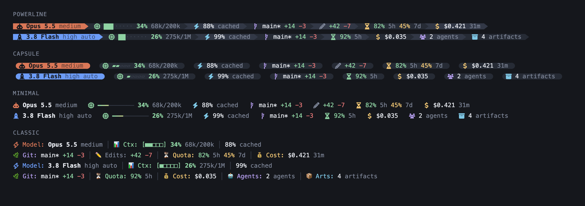

# agent-statusline

A themed, multi-line statusline for **Claude Code** and **Google Antigravity (`agy`)**. One renderer drives both tools, so you get the same look and the same metrics in each, and you can switch themes with one command.



## What it shows

| Row | Metrics |
| --- | --- |
| AI | Model, reasoning effort, mode · context window fill with a gauge (green → amber at 60% → red at 80%) · prompt cache hit rate |
| Environment | Git branch, dirty flag and uncommitted `+/-` lines (or the folder name outside a repo) · lines Claude edited this session · usage limits left (5h / 7d) · session cost and duration · tool approval alerts, subagents and artifacts (Antigravity) |

Wide windows get one line. When that doesn't fit, it splits into an AI row and an environment row, and in narrow windows each row wraps on its own, up to three lines.

## Themes

| Theme | Look | Needs |
| --- | --- | --- |
| `powerline` (default) | Joined arrow segments; the model segment is filled with the tool's color (clay for Claude, blue for Antigravity). Context bar fills in eighths of a cell. | Truecolor, Nerd Font |
| `capsule` | Rounded pills with a five-step context meter | Truecolor, Nerd Font |
| `minimal` | No backgrounds or labels; a ten-cell context track that shifts green → amber → red | Truecolor, Nerd Font |
| `classic` | Emoji and text labels with `│` separators | Truecolor |

[Ghostty](https://ghostty.org) ships the Nerd Font symbols, so the icon themes work there out of the box. In other terminals, install any [Nerd Font](https://www.nerdfonts.com) or use `classic`.

## Install

```bash
git clone https://github.com/NinzaRJ01/agent-statusline.git
cd agent-statusline
./install.sh                 # or: ./install.sh --theme minimal --no-agy
```

The installer:

- links `agent-statusline` into `~/.local/bin`
- sets `statusLine` in `~/.claude/settings.json` and, if present, `~/.gemini/antigravity-cli/settings.json`, keeping every other setting and saving a `*.bak-agent-statusline` backup first
- adds a `/statusline-theme` slash command to Claude Code
- writes the default theme (`powerline`) to `~/.config/agent-statusline/config.json` if you don't have one yet

It is safe to re-run. Python 3.8+ and `git` are the only requirements.

## Switch themes

```bash
agent-statusline theme                     # show the current theme per tool
agent-statusline theme capsule             # use capsule everywhere
agent-statusline theme minimal --tool agy  # only Antigravity
agent-statusline preview                   # print every theme with sample data
```

Inside Claude Code you can run `/statusline-theme minimal` instead. The change applies on the next statusline refresh.

Theme lookup order: the `AGENT_STATUSLINE_THEME` environment variable, then the per-tool setting, then the global setting, then `powerline`.

```json
{
  "theme": "powerline",
  "tools": { "agy": { "theme": "minimal" } }
}
```

Antigravity's own `/statusline on|off|reset` commands keep working.

## How it works

Both CLIs run a command for the statusline and stream a JSON snapshot of the session on stdin. `agent-statusline render --tool claude|agy` turns each tool's JSON into a common set of metrics (`agent_statusline/adapters.py`), and the selected theme draws them (`agent_statusline/themes.py`).

- Claude Code doesn't send the reasoning effort, so it is read from `modelSettings` in `~/.claude/settings.json`.
- Git calls time out after 80 ms each, and rendering never raises: on bad input it prints nothing and writes the error to `~/.cache/agent-statusline/error.log`.
- Set `AGENT_STATUSLINE_DEBUG=1` to save the last JSON each tool sent to `~/.cache/agent-statusline/`.

## Uninstall

```bash
./uninstall.sh
```

This removes the `statusLine` entries that point at agent-statusline, the `~/.local/bin` link and the slash command. Your theme config and the install backups are left in place.

## Development

```bash
python3 -m unittest discover -s tests
python3 tools/screenshot.py --nerd-font path/to/SymbolsNerdFontMono-Regular.ttf   # regenerate docs/themes.png
```

To add a theme, write a `bar(pct)` and a `line(segments, tool)` function in `themes.py` and register them in `THEMES`.

## License

MIT
